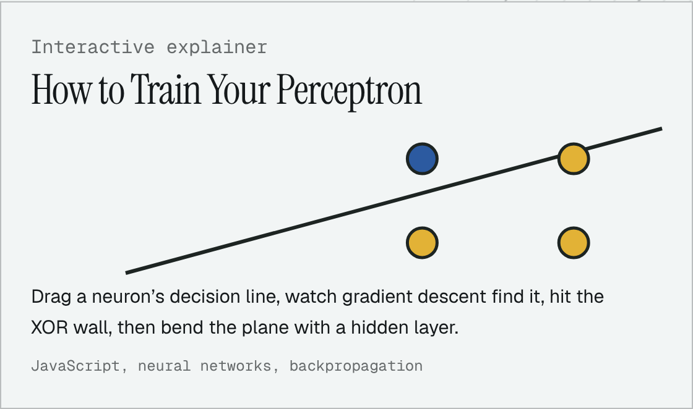
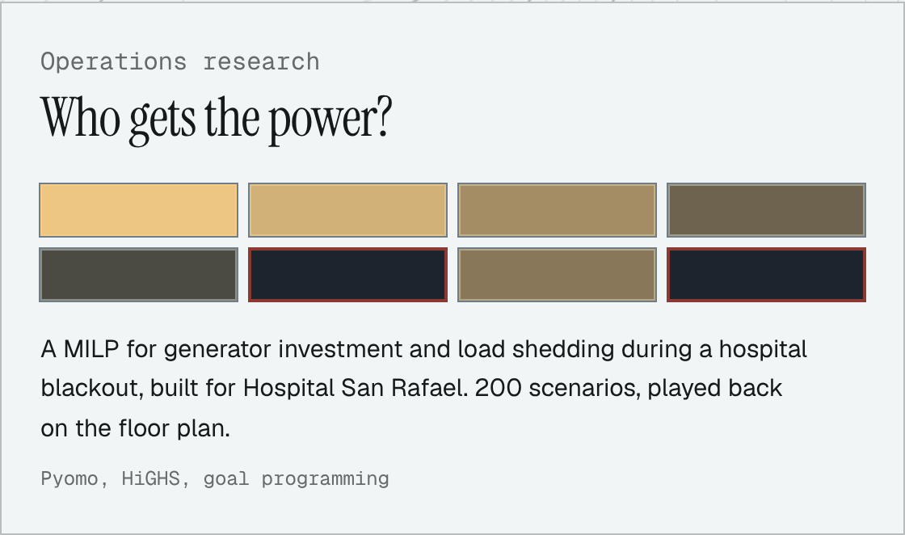
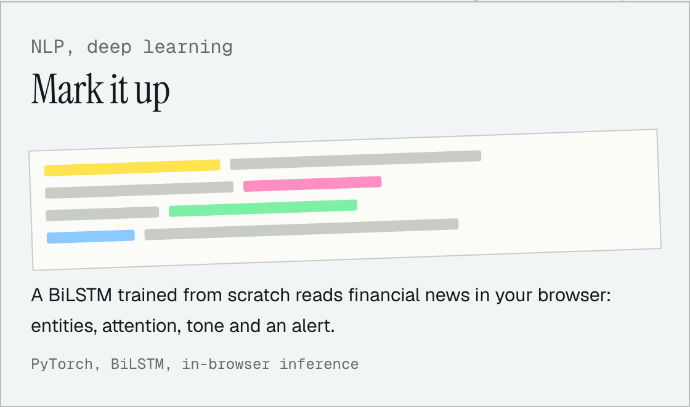
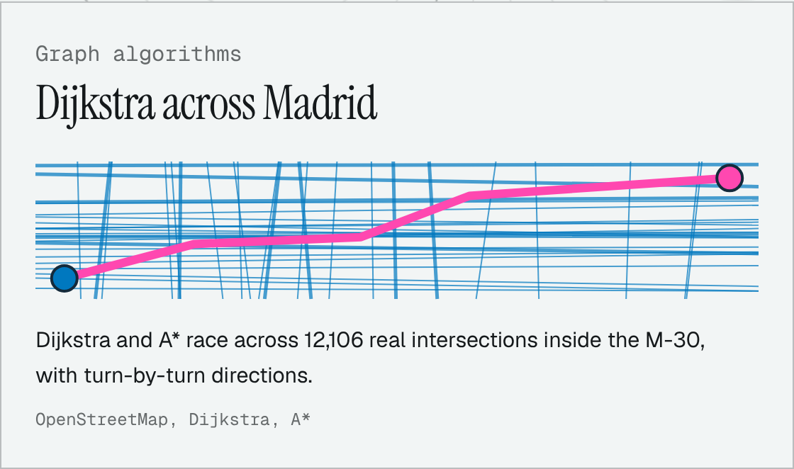
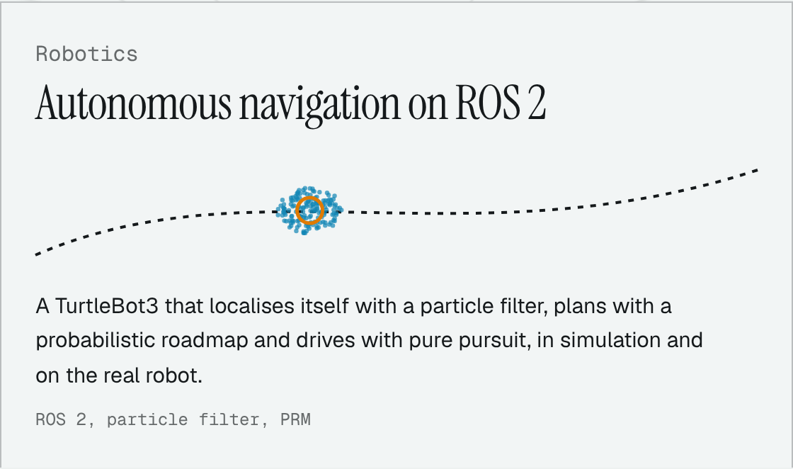
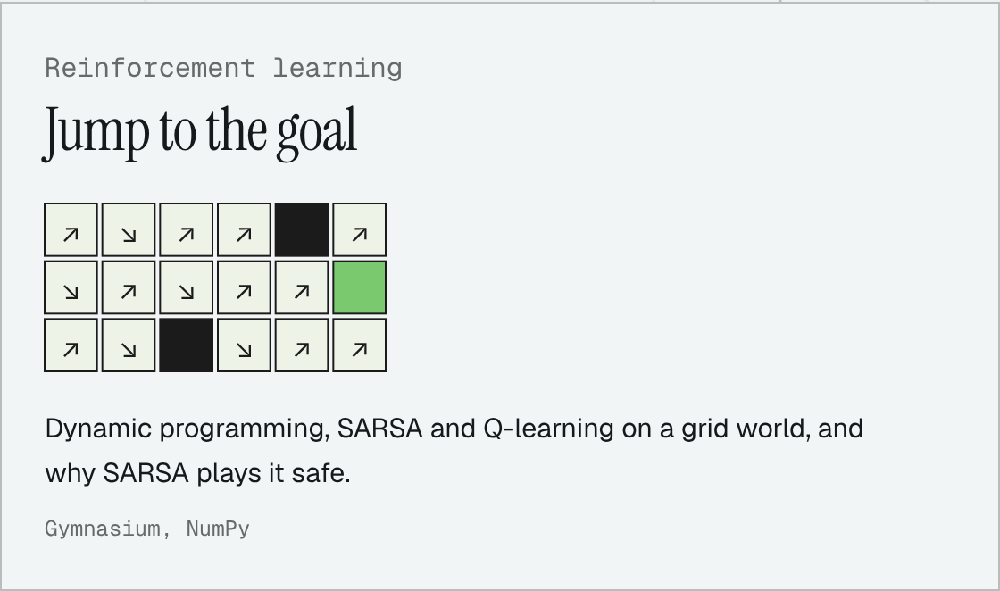

  <a href="https://liiiaamm.github.io"><b>liiiaamm.github.io</b></a>
  &nbsp;&nbsp;·&nbsp;&nbsp;
  <a href="https://www.linkedin.com/in/liamesgueva/">LinkedIn</a>
  &nbsp;&nbsp;·&nbsp;&nbsp;
  <a href="mailto:egsn.liam@gmail.com">egsn.liam@gmail.com</a>

Final-year **Mathematical Engineering and AI** student at Comillas ICAI, Madrid. I like problems where the maths has to survive real software: a model that runs on a robot, a forecast that drives a decision, an LLM that has to reason over a messy knowledge base.

**Now.** Writing my bachelor’s thesis on time-series foundation models (TimesFM) for energy forecasting, in collaboration with the **Barcelona Supercomputing Center (BSC)**. Back on the AI team at **Kearney** (Graph RAG over industrial knowledge graphs) after a summer internship. Before that, deep learning for financial time series at **Finaipro**. Exchange at **UIUC** in spring 2027.

## Projects

Most of these run in the browser. Click a card to open it.

<table>
<tr>
<td width="50%" valign="top">

<a href="https://liiiaamm.github.io/how-to-train-your-perceptron/"><b>Try it</b></a> · <a href="https://github.com/liiiaamm/how-to-train-your-perceptron">Code</a>

</td>
<td width="50%" valign="top">

<a href="https://liiiaamm.github.io/hospital-energy-optimization/"><b>Try it</b></a> · <a href="https://github.com/liiiaamm/hospital-energy-optimization">Code</a>

</td>
</tr>
<tr>
<td width="50%" valign="top">

<a href="https://liiiaamm.github.io/ai-financial-news-alerts/"><b>Try it</b></a> · <a href="https://github.com/liiiaamm/ai-financial-news-alerts">Code</a>

</td>
<td width="50%" valign="top">

<a href="https://liiiaamm.github.io/GraphNav/"><b>Try it</b></a> · <a href="https://github.com/liiiaamm/GraphNav">Code</a>

</td>
</tr>
<tr>
<td width="50%" valign="top">

<a href="https://github.com/liiiaamm/autonomous-navigation-ros2"><b>Code</b></a>

</td>
<td width="50%" valign="top">

<a href="https://github.com/liiiaamm/reinforcement-learning"><b>Code</b></a>

</td>
</tr>
</table>

**Also:** [Number Theory Lab](https://github.com/liiiaamm/number-theory-lab) (modular arithmetic from scratch, then RSA built and broken) · [Hologram Lab](https://github.com/liiiaamm/Hologram_AugmentedReality) (OpenCV augmented reality). A second-brain system for Obsidian, with agents and an LLM-readable wiki, is being cleaned up for release.

## Toolkit

**Languages:** Python · TypeScript · SQL · C++ · C# · R · MATLAB · Bash  
**ML and AI:** PyTorch · scikit-learn · Hugging Face · LangChain · LangGraph · RAG · multi-agent systems  
**Optimisation and robotics:** Pyomo · Gurobi · HiGHS · ROS 2  
**Infra:** Git · Docker · AWS · Databricks

## Outside the repo

Co-founder of the **ICAI Quantitative Finance Club** and Head of Partnerships at the **Comillas PE&VC Club**. Spanish native, English C1. Usually in the mountains when not at a keyboard: trail running, skiing, and some football.

The header is a day in the mountains, from first light to night, same as the website. The orange line is gradient descent with momentum on that terrain.
