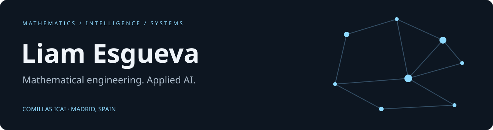

Final-year **Mathematical Engineering & AI** student at Comillas ICAI, Madrid. I like problems where the maths has to survive contact with real software: a model that has to run on a robot, a forecast that has to drive a decision, an LLM that has to reason over a messy knowledge base.

Previously at **Kearney** (Graph RAG and multi-agent systems for industrial fault diagnosis) and **Finaipro** (deep learning for financial time series). Currently writing my bachelor’s thesis on time-series foundation models (TimesFM) for energy forecasting, in collaboration with the **Barcelona Supercomputing Center (BSC)**.

[LinkedIn](https://www.linkedin.com/in/liamesgueva/) · [liam.esgon@gmail.com](mailto:liam.esgon@gmail.com)

## Projects

<table>
<tr>
<td width="50%" valign="top">

<h3><a href="https://github.com/liiiaamm/ai-financial-news-alerts">AI Financial News Alerts</a></h3>
News text and an optional chart in, a short alert out. NER and sentiment trained from scratch with a shared BiLSTM encoder, plus chart captioning with DePlot and Qwen2.5.
  <code>PyTorch</code> <code>BiLSTM-CRF</code> <code>NLP</code>
</td>
<td width="50%" valign="top">

<h3><a href="https://github.com/liiiaamm/autonomous-navigation-ros2">Autonomous Navigation on ROS 2</a></h3>
A TurtleBot3 that localizes itself from LiDAR with a particle filter, plans with a probabilistic roadmap and follows the path with pure pursuit.
  <code>ROS 2</code> <code>Particle filter</code> <code>PRM</code>
</td>
</tr>
<tr>
<td width="50%" valign="top">

<h3><a href="https://github.com/liiiaamm/hospital-energy-optimization">Hospital Energy Optimization</a></h3>
Which generators should a hospital buy, and who gets power during a blackout? A goal-programming MILP that trades off saving lives against keeping every unit running.
  <code>Pyomo</code> <code>MILP</code> <code>Operations research</code>
</td>
<td width="50%" valign="top">

<h3><a href="https://github.com/liiiaamm/how-to-train-your-perceptron">How to Train Your Perceptron</a></h3>
Interactive explainer: drag the weights, watch the decision boundary move, and see why one layer can't do XOR.
  <code>JavaScript</code> <code>Neural networks</code> <code>Education</code>
</td>
</tr>
</table>

**Also:** [Reinforcement Learning](https://github.com/liiiaamm/reinforcement-learning) (dynamic programming, SARSA vs Q-learning) · [GraphNav](https://github.com/liiiaamm/GraphNav) (Dijkstra on Madrid's street graph) · [Number Theory Lab](https://github.com/liiiaamm/number-theory-lab) (modular arithmetic, then RSA built and broken) · [Hologram Lab](https://github.com/liiiaamm/Hologram_AugmentedReality) (OpenCV augmented reality)

## Toolkit

**Languages:** Python · SQL · C++ · C# · Bash · R · MATLAB  
**ML & AI:** PyTorch · scikit-learn · Hugging Face · LangChain · LangGraph  
**Optimization & robotics:** Pyomo · Gurobi · ROS 2  
**Infra:** Git · Docker · AWS · Google Cloud

## Outside the repo

Founder of the **ICAI Quantitative Finance Club** and on the board of the **Comillas PE & VC Club**. Spanish native, English C1. Usually in the mountains when not at a keyboard.
